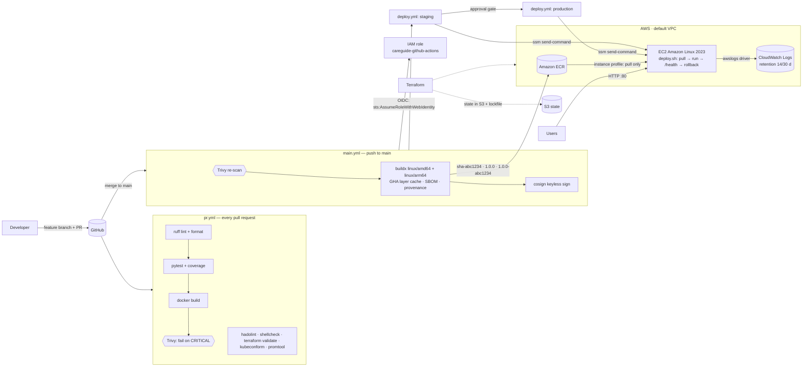
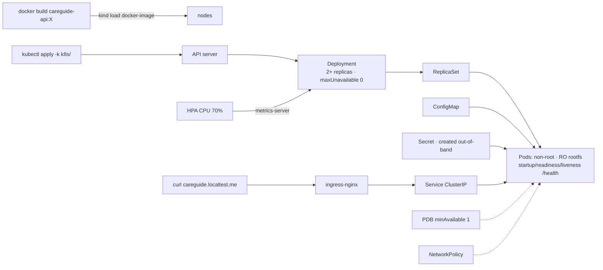
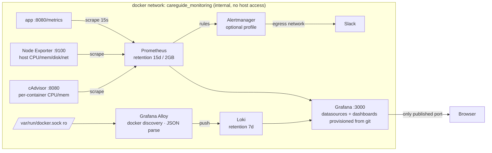

# CareGuide — DevOps Engineer Assessment

A small FastAPI service taken from source code to a production-ready, observable, securely deployed state:
containerization → CI/CD with security gates → Terraform on AWS (EC2) → Kubernetes (kind) →
Prometheus/Grafana/Loki/Alloy observability → Linux automation.

> **Execution guide:** [`docs/STEP_BY_STEP.md`](docs/STEP_BY_STEP.md) walks through doing and proving each step
> (commands, git commits, evidence to capture).

## Contents

- [Repository layout](#repository-layout)
- [Quick start](#quick-start)
- [Architecture](#architecture)
- [Step 1 — Application & containerization](#step-1--application--containerization)
- [Step 2 — CI/CD (GitHub Actions)](#step-2--cicd-github-actions)
- [Step 3 — Infrastructure as Code (Terraform)](#step-3--infrastructure-as-code-terraform)
- [Step 4 — Kubernetes](#step-4--kubernetes)
- [Step 5 — Observability](#step-5--observability)
- [Step 6 — Linux automation](#step-6--linux-automation)
- [Design decisions](#design-decisions)
- [Deployment & rollback strategy](#deployment--rollback-strategy)
- [Security considerations](#security-considerations)
- [AWS cost estimate](#aws-cost-estimate)
- [What I would improve with more time](#what-i-would-improve-with-more-time)
- [Use of AI tools](#use-of-ai-tools)

## Repository layout

```
.
├── app/                         FastAPI service (config, JSON logging, Prometheus metrics)
├── tests/                       pytest unit tests
├── Dockerfile                   multi-stage → distroless, non-root, HEALTHCHECK, OCI labels
├── docker-compose.yml           app on :8080 (healthcheck, restart policy, limits)
├── docker-compose.monitoring.yml  Prometheus, Grafana, Loki, Alloy, Node Exporter, cAdvisor (+ Alertmanager)
├── .github/workflows/
│   ├── pr.yml                   lint, test+coverage, hadolint, shellcheck, tf/k8s validation, Trivy
│   ├── main.yml                 multi-arch build, tag, scan, push to ECR, sign, deploy staging → prod
│   └── deploy.yml               reusable: SSM deploy + smoke test + auto-rollback (also manual rollback)
├── terraform/
│   ├── bootstrap/               S3 state bucket (versioned, encrypted, TLS-only)
│   ├── global/                  ECR repo + GitHub OIDC provider + CI role
│   └── app/                     per-env EC2, SG, IAM profile, CloudWatch logs, user data
├── k8s/                         Kustomize: Deployment, Service, Ingress, ConfigMap, HPA, PDB, NetworkPolicy
├── monitoring/                  prometheus/ (config, alerts, alert tests), loki/, alloy/, grafana/, alertmanager/
├── scripts/
│   ├── system_health.sh         host health script (+ systemd/ timer, cron/ entry)
│   └── k8s_rollout_demo.sh      zero-downtime rollout + rollback demo with live traffic
├── docs/                        STEP_BY_STEP.md, screenshots/
└── Makefile                     shortcuts for everything below (`make help`)
```

## Quick start

**Prerequisites:** Docker Engine 24+ with Compose v2, GNU Make (optional), Python 3.11+ (tests only).
For Kubernetes: `kind` ≥ 0.24, `kubectl` ≥ 1.30. For AWS: Terraform ≥ 1.10, AWS CLI v2.

```bash
git clone https://github.com/ahsanayon12/careguide_submission_12-11-2026.git && cd careguide_submission_12-11-2026

cp .env.example .env            # set GRAFANA_ADMIN_PASSWORD

# App only
docker compose up -d --build
curl -s localhost:8080/ | jq     # {"message":"Hello from DevOps Task!","status":"running","version":"1.0.0-local"}
curl -s localhost:8080/health    # {"status":"ok"}
curl -s localhost:8080/metrics | head

# App + full observability stack
docker compose -f docker-compose.yml -f docker-compose.monitoring.yml up -d --build
open http://localhost:3000       # log in with GRAFANA_ADMIN_USER / GRAFANA_ADMIN_PASSWORD from .env
```

Grafana opens on the **CareGuide – Application** dashboard; the other two are under *Dashboards → CareGuide*.
To generate traffic and an error spike (`CHAOS_ENABLED=true` is set in `.env.example`):

```bash
for i in $(seq 1 300); do curl -s localhost:8080/ >/dev/null; done
for i in $(seq 1 40);  do curl -s localhost:8080/chaos/error >/dev/null; done
```

| Task | Command |
|---|---|
| Unit tests + coverage | `pip install -r requirements-dev.txt && python -m pytest --cov=app` |
| Lint | `make lint` |
| Health script | `./scripts/system_health.sh --help` |
| Alert rule tests | `promtool test rules monitoring/prometheus/tests/alerts_test.yml` |
| Kubernetes | `make kind-up kind-load k8s-deploy` then `make k8s-rollout-demo` |
| Terraform | see [Step 3](#step-3--infrastructure-as-code-terraform) |
| Tear down | `docker compose -f docker-compose.yml -f docker-compose.monitoring.yml down -v` |

## Architecture

### CI/CD and AWS deployment



### Kubernetes deployment flow (kind)



### Observability data flow



## Step 1 — Application & containerization

**Service** (`app/`): FastAPI on Uvicorn.

| Endpoint | Behaviour |
|---|---|
| `GET /` | `{"message": "Hello from DevOps Task!", "status": "running", "version": "<APP_VERSION>"}` |
| `GET /health` | `{"status":"ok"}` — used for Docker HEALTHCHECK, K8s probes, deploy smoke tests |
| `GET /metrics` | Prometheus format: `http_requests_total{method,path,status}`, `http_request_errors_total{method,path}`, `http_request_duration_seconds` histogram, `http_requests_in_progress`, `app_info` |
| `GET /chaos/error` | Only when `CHAOS_ENABLED=true`; returns 500 to demo alerts/dashboards |

- **Configuration** from env only: `PORT`, `LOG_LEVEL`, `ENVIRONMENT`, `APP_VERSION`, `CHAOS_ENABLED` (invalid values fall back to safe defaults — tested).
- **Structured logs**: one JSON object per line on stdout (`ts, level, logger, msg, service, env, version` + request fields `method, path, status, duration_ms`). Uvicorn's own logs go through the same formatter. Probe/scrape paths are not access-logged (still counted in metrics).
- **Bounded metric labels**: the `path` label is the *route template*; unknown URLs are recorded as `path="unmatched"` so scanners can't explode cardinality (tested).
- **Graceful shutdown**: the container runs Python as PID 1 (exec-form `ENTRYPOINT`), Uvicorn handles SIGTERM, stops accepting connections, drains in-flight requests (`timeout_graceful_shutdown=20s`, below Compose `stop_grace_period: 25s` and K8s `terminationGracePeriodSeconds: 30`), then the lifespan hook logs the shutdown.
- **Tests**: `tests/test_main.py` — 7 tests, ~92% coverage (CI enforces ≥ 80%).

**Dockerfile** highlights:

| Requirement | Implementation |
|---|---|
| Multi-stage, minimal final image | `builder` (python:3.11.14-slim-bookworm) → `runtime` (`gcr.io/distroless/python3-debian12:nonroot`: no shell, no package manager). Optional `test` stage. |
| Pinned base | Explicit version tags; the header shows how to pin by `@sha256:` digest (recommended with Renovate). |
| Non-root | distroless `nonroot` + explicit `USER 65532:65532`. |
| HEALTHCHECK | Python stdlib `urllib` (no curl in distroless). |
| OCI labels | `org.opencontainers.image.{title,description,version,revision,created,source,licenses,base.name}` via build args. |
| `.dockerignore` | Context contains only `app/`, `tests/`, requirements, `pyproject.toml`. |
| Layer efficiency | Requirements copied and installed before source → dependency layer cached; `--no-compile`, no pip cache. |

**Final image size:** `<FILL IN after "make build", e.g. ~70 MB>` (distroless python3 base is ≈ 50 MB; FastAPI + Uvicorn + prometheus-client add ≈ 15–20 MB). CI prints the exact size in the PR job summary.

**docker-compose.yml**: port 8080, healthcheck, `restart: unless-stopped`, CPU/memory limits and reservations, plus hardening (`read_only`, `tmpfs /tmp`, `cap_drop: ALL`, `no-new-privileges`).

## Step 2 — CI/CD (GitHub Actions)

| Workflow     | Trigger                                     | Jobs                                                                                                                                                                                                                                                                                                                                                                                                                                                 |
| ------------ | ------------------------------------------- | ---------------------------------------------------------------------------------------------------------------------------------------------------------------------------------------------------------------------------------------------------------------------------------------------------------------------------------------------------------------------------------------------------------------------------------------------------- |
| `pr.yml`     | PR to `main`                                | **lint-test**: ruff lint + format, pytest, coverage XML + JUnit artifact, coverage in job summary · **lint-infra**: hadolint, shellcheck (all `*.sh` + Terraform templates), `terraform fmt/validate` for all 3 stacks, promtool rule check + alert unit tests, Alloy syntax, compose config, kubeconform · **build-scan**: build, container smoke test, report image size, **Trivy (exit 1 on CRITICAL)**, Trivy IaC misconfig scan (informational) |
| `main.yml`   | push to `main`                              | **build-push**: Trivy gate on the exact commit → buildx **linux/amd64 + linux/arm64** with GHA cache → push to ECR with tags `sha-<7>`, `<semver>`, `<semver>-<7>` → SBOM + provenance attestations → cosign keyless signature · **deploy-staging** → **deploy-production** (protected environment)                                                                                                                                                  |
| `deploy.yml` | called by main / manual `workflow_dispatch` | Finds the instance by tags, runs `/opt/careguide/deploy.sh <tag>` through **SSM Run Command**, on-host `/health` smoke test with **automatic rollback** to the previous tag, then an external smoke test (rolls back on failure too). Manual dispatch with an older tag = manual rollback.                                                                                                                                                           |

**Tagging:** `sha-<short-sha>` is the immutable deploy identity (what runs, and what you roll back to); the semantic version comes from the `VERSION` file (bump it in the PR that changes behaviour); `<semver>-<sha>` ties both together. `latest` is never used.

**Required GitHub configuration** (no secret is hardcoded anywhere):

| Name | Type | Value / source |
|---|---|---|
| `AWS_GITHUB_ROLE_ARN` | Secret | `terraform -chdir=terraform/global output -raw github_actions_role_arn` |
| `AWS_REGION` | Variable | e.g. `ap-southeast-1` |
| `ECR_REPOSITORY` | Variable | `careguide-api` |
| Environments `staging`, `production` | Settings → Environments | `production`: required reviewers (approval gate), deployment branch = `main` |

`GITHUB_TOKEN` is used implicitly; no AWS access keys exist. The OIDC trust policy only accepts tokens for `ref:refs/heads/main` and the two environments, so PRs/forks cannot assume the role.

**Evidence:** `docs/screenshots/ci-pr.png`, `docs/screenshots/ci-main-deploy.png` `<add after your first runs>`.

## Step 3 — Infrastructure as Code (Terraform)

Three small stacks so blast radius and lifecycle match:

| Stack | State | Creates |
|---|---|---|
| `terraform/bootstrap` | local (one-time) | S3 state bucket: versioning, SSE, public-access block, TLS-only policy, old-version expiry, `prevent_destroy` |
| `terraform/global` | S3 `careguide/global/terraform.tfstate` | ECR repo (scan on push, lifecycle: keep 30 `sha-*`), GitHub OIDC provider, least-privilege CI role |
| `terraform/app` | S3 `careguide/<env>/terraform.tfstate` | Security group, IAM role + instance profile, CloudWatch log group, EC2 + user data |

**State locking:** S3-native lockfile (`use_lockfile = true`, Terraform ≥ 1.10) — no DynamoDB table needed.

**Least privilege (instance profile):** `ecr:GetAuthorizationToken` (API has no resource scope) + pull actions on **this repo ARN only**; `logs:CreateLogStream/PutLogEvents/DescribeLogStreams` on **this log group only**; `AmazonSSMManagedInstanceCore` for SSM deploys and Session Manager. No static keys; IMDSv2 required with hop limit 1 so containers cannot read instance credentials.

**Security group:** inbound TCP 80 only (configurable CIDRs). **No port 22** — shell access is `aws ssm start-session`. Egress limited to 80/443.

**Bootstrap (user data):** installs Docker on Amazon Linux 2023, sets `live-restore` and bounded local logs, writes `/etc/careguide/deploy.env` and `/opt/careguide/deploy.sh`, and performs the first deploy. Container logs go to **CloudWatch Logs via the** `awslogs` **driver** with 14-day (staging) / 30-day (production) retention.

**Environments:** same code, `environments/staging.tfvars` vs `environments/production.tfvars` (instance size, disk, retention, detailed monitoring) and a separate state key.

```bash
# 0. one-time
cd terraform/bootstrap
terraform init && terraform apply -var="state_bucket_name=careguide-tfstate-<unique>"
cd .. && cp backend.hcl.example backend.hcl   # set bucket name

# 1. shared resources
terraform -chdir=global init -backend-config=../backend.hcl -backend-config="key=careguide/global/terraform.tfstate"
terraform -chdir=global apply -var="github_repository=<owner>/CareGuide"
#   -> put output github_actions_role_arn into the GitHub secret AWS_GITHUB_ROLE_ARN
#   -> merge to main once so CI pushes the first image (1.0.0 / sha-*)

# 2. an environment (repeat with production)
terraform -chdir=app init -backend-config=../backend.hcl -backend-config="key=careguide/staging/terraform.tfstate"
terraform -chdir=app plan  -var-file=environments/staging.tfvars -out=staging.tfplan
terraform -chdir=app apply staging.tfplan
curl "http://$(terraform -chdir=app output -raw public_ip)/health"

# 3. clean up
terraform -chdir=app destroy -var-file=environments/staging.tfvars
```

> Switching environments in the same checkout: re-run `init -reconfigure` with the other state key.

**Evidence:** `docs/screenshots/terraform-plan.png`, `terraform-apply.png`, `cloudwatch-logs.png` `<add after apply>`.

## Step 4 — Kubernetes

Manifests (Kustomize) in `k8s/`: Namespace (Pod Security **restricted** enforced), ServiceAccount (no token automount), ConfigMap, Deployment, Service, Ingress, HPA, PodDisruptionBudget, NetworkPolicy, plus `kind-cluster.yaml`.

| Requirement | Implementation |
|---|---|
| ≥ 2 replicas, rolling update | `replicas: 2`, `maxSurge: 1`, `maxUnavailable: 0`, `minReadySeconds: 5`, `progressDeadlineSeconds: 120` |
| Probes on `/health` | `startupProbe` (≤ 30 s boot), `readinessProbe` (5 s), `livenessProbe` (10 s) |
| Requests/limits | `50m / 64Mi` requests, `500m / 256Mi` limits |
| Service + Ingress | ClusterIP Service; ingress-nginx host `careguide.localtest.me` (resolves to 127.0.0.1). Alternative: `kubectl -n careguide port-forward svc/careguide-api 8080:80` |
| ConfigMap + Secret | `careguide-config` via `envFrom`; `careguide-secrets` referenced by `secretKeyRef` but **never committed** — created with `kubectl create secret` (see `secret.example.yaml`) |
| securityContext | `runAsNonRoot`, uid/gid 65532, `readOnlyRootFilesystem`, `allowPrivilegeEscalation: false`, drop ALL caps, seccomp `RuntimeDefault`; `/tmp` is an `emptyDir` |
| HPA | CPU 70% of request, 2–6 replicas, fast scale-up, 5-min scale-down stabilization |
| Graceful termination | `preStop` native `sleep: 5` (distroless has no `/bin/sleep`) so endpoints are removed before SIGTERM |

```bash
make kind-up        # kind cluster (1 cp + 2 workers), ingress-nginx, metrics-server
make kind-load      # build careguide-api:1.0.0 and load it into kind
make k8s-deploy     # create secret if missing, kubectl apply -k k8s, wait for rollout
curl -s http://careguide.localtest.me/
kubectl -n careguide get deploy,pods,svc,ingress,hpa
```

### Zero-downtime rolling update and rollback

`make k8s-rollout-demo` (`scripts/k8s_rollout_demo.sh`) builds `1.1.0`, starts a request loop (10 req/s), runs the update and the rollback, and counts failed requests. The core commands:

```bash
kubectl -n careguide set image deployment/careguide-api api=careguide-api:1.1.0
kubectl -n careguide rollout status deployment/careguide-api
kubectl -n careguide rollout history deployment/careguide-api
kubectl -n careguide rollout undo deployment/careguide-api
kubectl -n careguide rollout status deployment/careguide-api
```

Output from my run:

```text
<PASTE the output of `make k8s-rollout-demo` here. It should end with
 "requests: N  ok: N  failed: 0" after the update and after the rollback,
 and GET / reporting version 1.1.0 then 1.0.0.>
```

Why it's zero-downtime: `maxUnavailable: 0` keeps full capacity, a new pod only receives traffic after its readiness probe passes, and old pods are removed from endpoints (preStop sleep) before they get SIGTERM and drain.

### How this changes on EKS

- **Ingress:** AWS Load Balancer Controller (ALB Ingress) with ACM TLS certificates, WAF, and target-type `ip`; external-dns for Route 53.
- **Secrets:** External Secrets Operator (or Secrets Store CSI driver) syncing from AWS Secrets Manager / SSM Parameter Store, with KMS envelope encryption of etcd secrets enabled on the cluster.
- **IAM:** IRSA or EKS Pod Identity on the ServiceAccount (annotation placeholder already in `serviceaccount.yaml`) — no node-wide credentials.
- **Node autoscaling:** Karpenter (or Cluster Autoscaler + managed node groups) across ≥ 3 AZs; topology spread by zone instead of hostname.
- **Images:** ECR with image signature verification (Kyverno/Sigstore policy controller) at admission.
- **Delivery:** GitOps (Argo CD / Flux) applying Kustomize overlays or a Helm chart per environment, progressive delivery (Argo Rollouts canary with Prometheus analysis).
- **Observability:** kube-prometheus-stack + Loki/Alloy as DaemonSet, or Amazon Managed Prometheus/Grafana; VPC CNI network policies.

## Step 5 — Observability

All six mandatory components run from `docker-compose.monitoring.yml`; every image is pinned.

| Component | Image | Role | Exposed to host? |
|---|---|---|---|
| Prometheus | `prom/prometheus:v3.5.0` | scrapes app, node-exporter, cAdvisor (+ itself, Loki, Alloy, Grafana); **retention 15d / 2 GB** | no |
| Loki | `grafana/loki:3.5.3` | log store, TSDB schema v13, **retention 168h** (compactor) | no |
| Grafana Alloy | `grafana/alloy:v1.10.2` | Docker discovery → tail logs → parse JSON → Loki | no |
| Node Exporter | `prom/node-exporter:v1.9.1` | host CPU, memory, disk, network | no |
| cAdvisor | `gcr.io/cadvisor/cadvisor:v0.52.1` | per-container CPU/memory/network | no |
| Grafana | `grafana/grafana:12.1.1` | dashboards, provisioned from git | **yes, :3000 only** |
| Alertmanager (bonus) | `prom/alertmanager:v0.28.1` | routes alerts to Slack (`--profile alerting`) | no |

**Networks:** `careguide_monitoring` is `internal: true` (no published ports, no egress). Grafana additionally joins `careguide_grafana_public`, the only network with a published port. Alertmanager joins an `egress` network solely to reach Slack.

### Logs: parsing and label choices

Alloy (`monitoring/alloy/config.alloy`) discovers all containers through the read-only Docker socket. For the app it parses the JSON line, uses the app's own `ts` as the timestamp, and splits fields deliberately:

| Field | Stored as | Why |
|---|---|---|
| `service`, `container`, `stream` | **label** | a handful of values; the natural entry point for every query |
| `level` (normalized: `warning` → `warn`) | **label** | ≤ 5 values; makes `{service="app", level="error"}` an index lookup |
| `path`, `method`, `status`, `logger` | **structured metadata** | filterable (`\| path="/chaos/error"`) without creating new streams; `path` is already bounded by the app, but status × method × path as labels would multiply streams for little gain |
| `duration_ms`, `client`, `msg` | log body only | unbounded — never labels |

Verified locally: Loki labels = `container, level, service`; `{service="app", level="error"} | path="/chaos/error"` returns the expected lines with `method/status/path` as metadata. Non-app containers get a best-effort `level` from `level=...` logfmt.

### Dashboards (provisioned as code)

Datasources (`uid: prometheus`, `uid: loki`) and dashboards are provisioned from `monitoring/grafana/provisioning/` and `monitoring/grafana/dashboards/*.json` (`allowUiUpdates: false` — change JSON in git, not the UI).

| Dashboard | Panels |
|---|---|
| **CareGuide – Application** | status, request rate, 5xx ratio, p95, in-flight · request rate by path/status · error ratio with alert-threshold band · **p50/p95/p99** · p95 by path · **Loki: error/warn logs** and **request logs** (path filter) directly below the metrics · log volume by level |
| **CareGuide – Host** | CPU, memory, root disk, load, cores, uptime · CPU by mode · memory breakdown · load average · disk usage per mountpoint · disk I/O · network rx/tx · network errors/drops |
| **CareGuide – Containers** | CPU cores per container · CPU % of limit · memory working set · **memory % of limit** (with 90% alert band) · current memory-vs-limit gauge · network per container · Loki logs for the selected container(s) |

Every query was executed against a live Prometheus/Loki while building this repo (all parse; app and host panels return data).

**Screenshots:** `docs/screenshots/grafana-application.png`, `grafana-host.png`, `grafana-containers.png` `<add after running the stack>`.

### Alerting

Rules: `monitoring/prometheus/rules/alerts.yml`; unit tests: `monitoring/prometheus/tests/alerts_test.yml` (`promtool test rules`, run in CI).

| Alert | Condition | `for` | Severity | Reasoning |
|---|---|---|---|---|
| `CareGuideAppDown` | `up{job="careguide-app"} == 0` | 1m | critical | 4 failed scrapes at 15 s — long enough to ignore a restart blip, short enough that users are actually affected. |
| `CareGuideHighErrorRate` | 5xx ratio > 5% **and** > 0.1 req/s | 5m | critical | 5% is far above a healthy baseline (~0%) and burns a 99.9% SLO's monthly budget in hours. The traffic floor prevents one failed request at 3 a.m. from paging (tested). |
| `CareGuideHighLatencyP95` | p95 > 500 ms | 10m | warning | The service does trivial work (p95 ~ms); 500 ms means saturation or a dependency problem. 10 min avoids paging on GC/cold-start bursts. |
| `HostDiskUsageHigh` | > 80% | 10m | warning | Time to act before it's urgent; 10 min ignores temporary files during builds/pulls. |
| `HostDiskUsageCritical` | > 90% | 5m | critical | Little headroom left (Docker pulls, logs); inhibits the 80% warning. |
| `HostHighCpuUsage` | > 90% | 15m | warning | Short CPU peaks are normal; sustained saturation degrades latency. |
| `HostMemoryUsageHigh` | > 90% (MemAvailable-based) | 10m | warning | Uses MemAvailable so page cache isn't counted as "used". |
| `ContainerMemoryNearLimit` | working set > 90% of limit | 5m | warning | Working set is what the OOM killer compares; at 90% an OOM kill is imminent. |
| `ScrapeTargetDown` | any other target down | 5m | warning | Detects a blind monitoring stack. |

Alertmanager (bonus) groups by alertname/severity, routes critical separately, and inhibits error-rate/latency alerts while the app is down. Enable with:

```bash
echo 'https://hooks.slack.com/services/XXX/YYY/ZZZ' > monitoring/alertmanager/secrets/slack_webhook_url
docker compose -f docker-compose.yml -f docker-compose.monitoring.yml --profile alerting up -d
```

### Hygiene: host mounts and privileges

| Container | Grants | Why |
|---|---|---|
| Node Exporter | `/:/host:ro,rslave`, `pid: host`, `read_only`, `cap_drop: ALL` | Needs the host's `/proc`, `/sys` and filesystems to report host — not container — metrics; read-only, no capabilities. |
| cAdvisor | `/:/rootfs:ro`, `/var/run:ro`, `/sys:ro`, `/var/lib/docker:ro`, `/dev/disk:ro`, device `/dev/kmsg` — **not privileged** | Reads cgroup stats and Docker metadata. If your host shows no container metrics (some cgroup v1 / Docker Desktop setups), add `privileged: true` to cAdvisor — a documented trade-off, still on an internal network. |
| Alloy | `/var/run/docker.sock:ro` | Container discovery and log tailing. Note: socket access is powerful even read-only; in production use the Docker log files or a socket proxy limited to `GET /containers`. |
| Grafana | admin user/password from `.env` (`${VAR:?}` — compose refuses to start without them), sign-up and anonymous access disabled | No hardcoded credentials. |

> Docker Desktop (macOS/Windows): Node Exporter reports the Docker VM, not your laptop — expected.

### Walkthrough: "An error spike appears on the Application dashboard. How do you find the cause?"

1. **Confirm and scope** — on *Application*, the *Error rate* panel shows the ratio and errors/s **by path**: is it one route or all of them? *Request rate by path & status* shows whether traffic also changed (a traffic surge vs. a regression at constant load) and which status codes.
2. **Correlate latency** — rising p95/p99 together with errors points to saturation or a slow dependency; errors with flat latency point to a code/config error.
3. **Read the logs in the same view** — the *Error & warning logs* panel directly below covers the same time range. Expand a line: `path`, `status`, `method`, `duration_ms`, and `exc_info` (stack trace) for unhandled exceptions. Narrow it in Explore, e.g. `{service="app", level="error"} | path="/chaos/error" | json | line_format "{{.msg}} {{.exc_info}}"`, or `sum by (path) (count_over_time({service="app", level="error"}[1m]))`.
4. **Check for a deploy** — the `version` field in every log line (and `app_info`) shows whether the spike started with a new version → roll back (see below).
5. **Rule out resources** — *Containers*: is the app near its memory limit (OOM restarts) or CPU-throttled at its limit? *Host*: disk full, CPU saturated, memory pressure?
6. **Act and verify** — roll back / fix / scale, then watch the error ratio return under 5% and `CareGuideHighErrorRate` resolve.

## Step 6 — Linux automation

`scripts/system_health.sh` — pure Bash + coreutils/procps, Linux `/proc` based.

- Collects CPU usage (two `/proc/stat` samples), memory (`MemAvailable`-based), disk usage for **all real filesystems** (pseudo filesystems excluded), load average (+ core count), **top 5 processes by memory**.
- Appends a timestamped entry to `health_log.txt` (path via `--log-file`); `--json` prints JSON and writes **one JSON object per line** (easy to ship/parse).
- Thresholds: `--cpu 90 --mem 85 --disk 80` (warning) and `--cpu-crit 95 --mem-crit 95 --disk-crit 90`; validated (1–100, crit ≥ warn). Also settable via `HEALTH_*` env.
- Prints `[WARNING]` / `[CRITICAL]` lines; breaches always go to stderr even with `--quiet`/`--json`.
- Exit codes: **0 OK, 1 WARNING, 2 CRITICAL, 3 UNKNOWN** (bad usage/collection failure).
- Log rotation: size-based (`--max-size`, default 1 MiB), keeps `--keep` files (default 5); `flock` prevents interleaved writes from overlapping runs.
- `set -Eeuo pipefail`, ERR trap, `--help`, `--version`, **shellcheck clean** (CI-enforced).
- Bonus: `HEALTH_WEBHOOK_URL` → posts a Slack/Discord-compatible message on WARNING/CRITICAL.

```bash
./scripts/system_health.sh                          # human-readable, logs to ./health_log.txt
./scripts/system_health.sh --disk 80 --cpu 90 --mem 85
./scripts/system_health.sh --json | jq .
./scripts/system_health.sh -q; echo "exit=$?"
```

**Scheduling every 5 minutes** — systemd (preferred: journald capture, `Persistent=` catch-up, sandboxing with `DynamicUser`, `ProtectSystem=strict`):

```bash
sudo install -m 0755 scripts/system_health.sh /usr/local/bin/system_health.sh
sudo cp scripts/systemd/system-health.{service,timer} /etc/systemd/system/
sudo systemctl daemon-reload && sudo systemctl enable --now system-health.timer
systemctl list-timers system-health.timer
journalctl -u system-health --since -1h
```

Or cron: `sudo install -m 0644 scripts/cron/system-health.cron /etc/cron.d/system-health`.
`SuccessExitStatus=1 2` keeps warnings from marking the unit "failed" while the result stays visible in the journal and log.

## Design decisions

| Decision | Choice | Trade-off |
|---|---|---|
| Language | Python FastAPI | Fast to write and test; mature Prometheus client. Go would give a smaller static binary (≈ 10 MB on `distroless/static`). |
| Base image | **distroless** over Alpine | No shell/package manager → much smaller attack surface and fewer CVEs; glibc avoids musl wheel issues. Cost: no `docker exec sh` for debugging (use `kubectl debug` / ephemeral containers) and the builder must match distroless's Python 3.11. |
| Compute | **EC2** over ECS/EKS | Matches the brief, Free Tier friendly, shows the fundamentals (bootstrap, IAM, logs). ECS Fargate would be my production choice for a single stateless service (managed rollouts, ALB integration, no hosts to patch); EKS only pays off with many services/teams. |
| Deploy mechanism | **SSM Run Command** over SSH | No port 22, no SSH keys in GitHub, every command audited in CloudTrail/SSM history. |
| Registry | **ECR + GitHub OIDC** | Same IAM model as the instance (pull via instance profile); no long-lived keys; scan on push. GHCR would need a pull token on the instance. |
| Tagging | `sha-<7>` (deploy identity), `<semver>`, `<semver>-<7>`; never `latest` | SHA tags are exact and make rollback deterministic; semver is for humans/releases. |
| Secrets | GitHub Secrets/Environments for CI; IAM roles everywhere at runtime; K8s Secret created out-of-band; Grafana creds from `.env`; Slack URL as Docker secret file | Nothing sensitive in git. Production: Secrets Manager + External Secrets, or Sealed Secrets/SOPS for GitOps. |
| State | 3 stacks, S3 native locking | Shared resources (ECR, OIDC) aren't destroyed with an environment; no DynamoDB table to manage. |
| Log labels | `service, container, level` as labels; request fields as structured metadata | Low stream count, still fully filterable — see Step 5. |
| Logs on EC2 | Docker `awslogs` driver | No agent to install/patch; retention managed by Terraform. CloudWatch agent would add host metrics. |

## Deployment & rollback strategy

**Path to production**

1. Feature branch → PR: lint, tests (coverage gate), Dockerfile/shell/IaC/K8s/alert-rule validation, image build + smoke test, **Trivy blocks CRITICAL CVEs**. Branch protection requires these checks + review.
2. Merge to `main`: re-scan, build multi-arch, push immutable `sha-*` tag (+ semver), sign, attach SBOM/provenance.
3. **Staging** deploys automatically via SSM; `deploy.sh` pulls, swaps the container, polls `/health` (20 × 3 s); the workflow then smoke-tests from outside.
4. **Production** waits for approval on the protected `production` environment, then the same steps with the same image digest that passed staging.

**Rollback**

- **Automatic:** if the on-host health check fails, `deploy.sh` restarts the previously recorded tag and the job fails; if the external smoke test fails, the workflow calls `deploy.sh --rollback`.
- **Manual (fast):** *Actions → Deploy to EC2 → Run workflow* with any previous `sha-`* tag (kept for the last 30 builds by the ECR lifecycle policy), or on the host `sudo /opt/careguide/deploy.sh --rollback` via Session Manager.
- **Kubernetes:** `kubectl rollout undo deployment/careguide-api` (revision history 5); a failed rollout stalls at `progressDeadlineSeconds` without taking old pods down because of `maxUnavailable: 0`.
- **Infrastructure:** Terraform changes go through `plan` in PR review; state is versioned in S3 so a bad state write can be restored.

**Known limitation:** a single EC2 instance has a few seconds of downtime while the container is swapped. For true zero-downtime on EC2: two instances behind an ALB with rolling target deregistration, or blue/green containers behind a local reverse proxy — or move to ECS.

## Security considerations

- **Secrets:** none in git (`.gitignore` covers `.env`, tfvars overrides, real K8s secret, Slack webhook file). CI authenticates to AWS with short-lived OIDC credentials; the role trusts only `main` and the two protected environments. Runtime uses instance-profile/IRSA roles. Grafana admin credentials are mandatory env vars.
- **Image scanning & supply chain:** Trivy gate on PRs and again on `main` before pushing (CRITICAL fails the build; `ignore-unfixed` avoids blocking on issues with no fix); Trivy IaC config scan; ECR scan-on-push; distroless base; pinned versions; SBOM + provenance attestations; cosign keyless signatures. Recommended next: pin actions and base images by digest with Renovate.
- **IAM:** least privilege, resource-scoped where the API allows (ECR repo ARN, log group ARN, SSM `SendCommand` only on instances tagged `Project=careguide` and only the `AWS-RunShellScript` document). No IAM users or access keys.
- **Network exposure:** EC2 accepts only TCP 80 (should be the ALB/CloudFront only, with HTTPS, in production); no SSH; egress 80/443 only; IMDSv2 with hop limit 1. Monitoring backends sit on an internal Docker network; only Grafana is published. K8s NetworkPolicy restricts pod ingress to the ingress controller, monitoring and same namespace.
- **Runtime hardening:** non-root uid 65532, read-only root FS, all capabilities dropped, `no-new-privileges`, seccomp `RuntimeDefault`, Pod Security `restricted` enforced, no service-account token mounted, resource limits everywhere, encrypted EBS.
- **Gaps (honest):** HTTP not HTTPS on EC2 (needs a domain + ACM on an ALB); Alloy's Docker socket mount; `/chaos/error` must stay disabled outside demos (it is off by default).

## AWS cost estimate

Rough **on-demand** list prices for `ap-southeast-1` (Singapore) — verify with the [AWS Pricing Calculator](https://calculator.aws/); excludes Free Tier and taxes.

| Item | This design (prod) | Notes |
|---|---|---|
| EC2 `t3.small` 24×7 | ≈ $19 | ~$0.026/h |
| EBS gp3 20 GB | ≈ $2 | |
| Public IPv4 address | ≈ $3.6 | $0.005/h |
| CloudWatch Logs (~2 GB ingest, 30 d) | ≈ $1.5 | |
| EC2 detailed monitoring | ≈ $2 | |
| ECR (~1–2 GB images) | ≈ $0.2 | |
| S3 state, SSM, data transfer (< 100 GB out) | < $1 | |
| **Total production** | **≈ $30 / month** | staging on `t3.micro` adds ≈ $14 |

A more production-grade setup (2 × `t3.small` across AZs behind an ALB with HTTPS, Route 53, CloudWatch alarms) would be roughly **$70–90/month**; ECS Fargate (2 × 0.25 vCPU/0.5 GB tasks + ALB) is in a similar range without hosts to patch.

## What I would improve with more time

- ALB + HTTPS (ACM) + two instances (or ECS Fargate) for real zero-downtime and AZ redundancy; WAF.
- Helm chart with staging/production values files; Argo CD (GitOps) and Argo Rollouts canaries gated on Prometheus error-rate analysis.
- Run kube-prometheus-stack + Loki on the cluster; OpenTelemetry tracing with Grafana Tempo and trace↔log correlation (trace_id in JSON logs).
- SLOs (availability/latency) with multi-window burn-rate alerts instead of static thresholds.
- Renovate for digest pinning of base images and GitHub Actions; Cosign signature verification at deploy/admission; Trivy/Grype on a schedule for already-deployed images.
- Terratest/`terraform test` for modules; tflint and Checkov as blocking gates; `infracost` comment on PRs.
- Ansible playbook for host hardening (CIS basics, unattended security updates) and installing the health script.
- Load testing (k6) in CI to validate the HPA and the latency alert.

## Use of AI tools

`<Write this in your own words. Example:>` I used an AI assistant (Claude) to help scaffold boilerplate, draft documentation, and review configurations. I reviewed, tested, and adjusted every file myself, and I can explain each design decision and line of code in this repository. Configurations were verified with the native tools (pytest, ruff, shellcheck, `terraform validate`, kubeconform, promtool rule tests, amtool, Alloy, and live Prometheus/Loki queries).
# careguide_submission_12-11-2026
